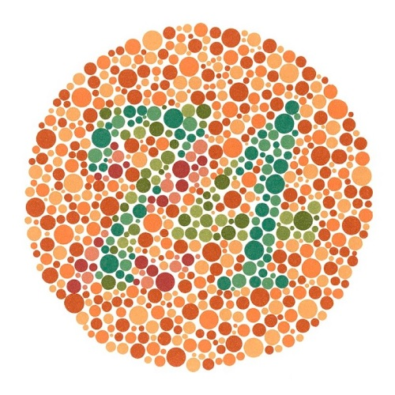
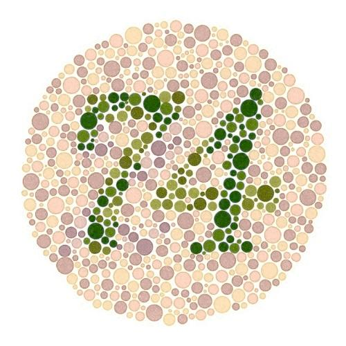
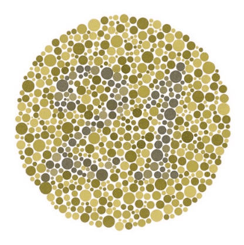
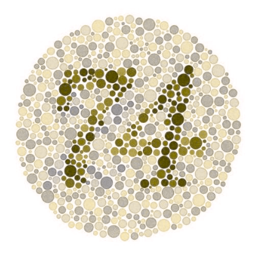
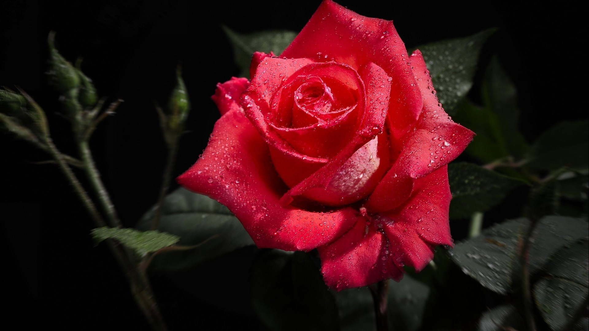
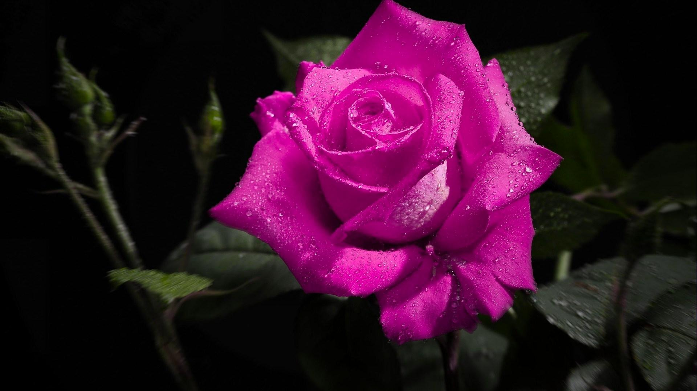
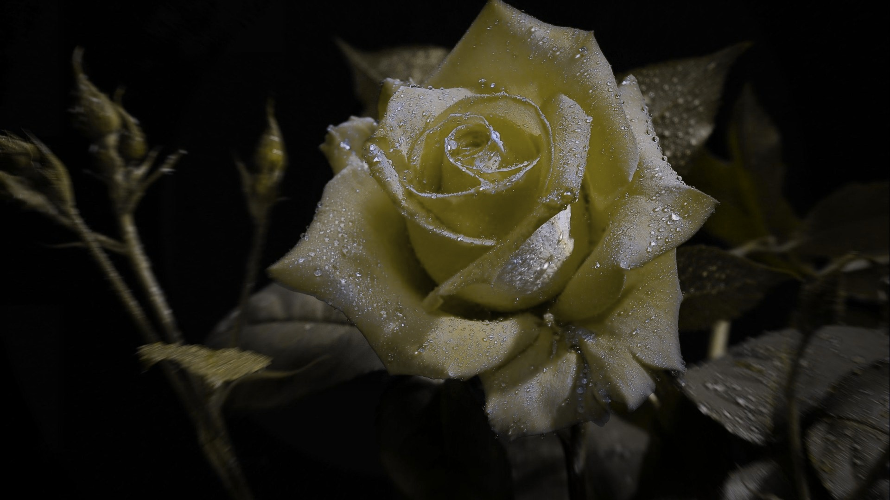
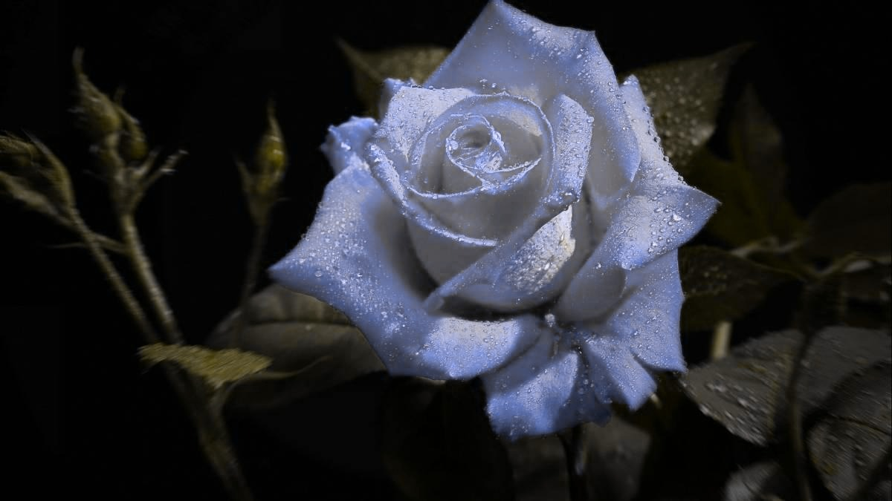

# Daltonize API

[](https://www.python.org/)
[](https://flask.palletsprojects.com/en/stable/)

**Daltonize API** is a public Flask-based service that processes images to generate colorblind-friendly versions. Originally built as the backend for my [See Colors](https://github.com/MelvinDinh3302/seecolors) React Native app, it's open and available for anyone to use.

## Run It on Your Local Machine

### Requirements
- Python 3.x
- curl

### Installation & Usage

1. **Install dependencies**  
   Run the following command to install required Python packages:
   ```bash
   pip install -r requirements.txt
   ```

2. **Start the Flask server**  
   Launch the API locally by running:
   ```bash
   python3 app.py
   ```

3. **Send a request using curl**  
   Use the following command to send an image to the API and receive the daltonized version:
   ```bash
   curl -X POST -F "image=@<input>" -F "type=<type>" http://<your_host_ip>:5000/daltonize --output <output>
   ```
   - `type` is optional. Use `p` for protan, `d` for deutan (the default), or `t` for tritan.
   - `severity` is optional and accepts values from `0` to `1`. The default is `1`, the maximum filter setting. A value of `0` skips color correction and still returns a JPEG.

For example, apply the deutan filter at severity `0.6`:

   ```bash
   curl -f -F "image=@test/flower.jpg" -F "type=d" -F "severity=0.6" \
   http://127.0.0.1:5000/daltonize --output result.jpg
   ```

## Run It Online (Recommended)

### Requirements
- curl

### Usage
Simply replace the local endpoint `http://<your_host_ip>:5000/daltonize` with the hosted API URL `https://daltonize-api.up.railway.app/daltonize`

**Example**
```bash
curl -X POST -F "image=@flower.jpg" -F "type=p" https://daltonize-api.up.railway.app/daltonize --output result.jpg
```

## Demonstration
Ishihara Test (Protanopia/Red-blind)

| Vision Type       | Original Image               | Daltonized Image               |
|-------------------|------------------------------|--------------------------------|
| **Normal Vision** |  |  |
| **Colorblind Vision** |  |  |

Flower (Deuteranopia/Green-blind)

| Vision Type       | Original Image               | Daltonized Image               |
|-------------------|------------------------------|--------------------------------|
| **Normal Vision** |  |  |
| **Colorblind Vision** |  |  |

## Acknowledgments
This API was originally built on [Joerg Dietrich’s Daltonize library](https://github.com/joergdietrich/daltonize).

The current version uses a Python port of Chromium’s ChromeOS color vision correction filter. The switch adds adjustable severity and uses a better correction matrix for protan, deutan, and tritan color vision deficiencies. [Chromium 138.0.7204.97 source](https://chromium.googlesource.com/chromium/src/+/refs/tags/138.0.7204.97/ash/color_enhancement/color_enhancement_controller.cc)
